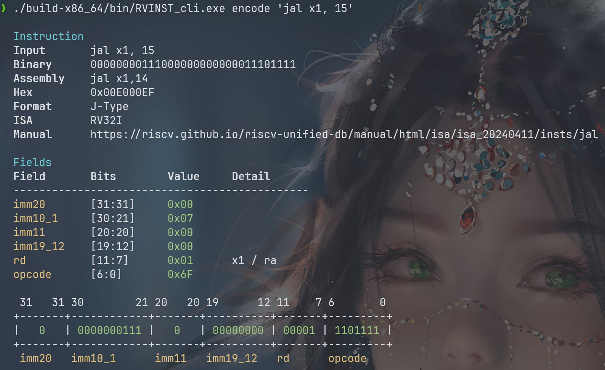
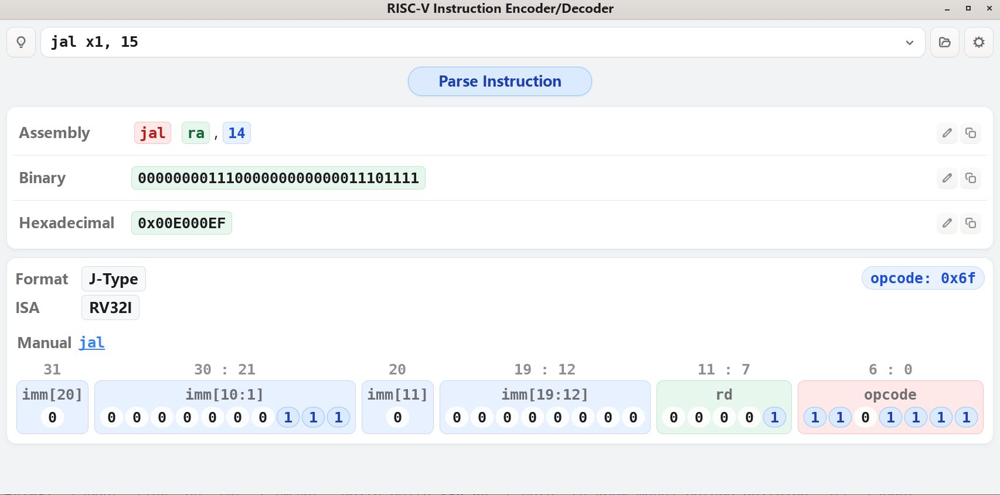
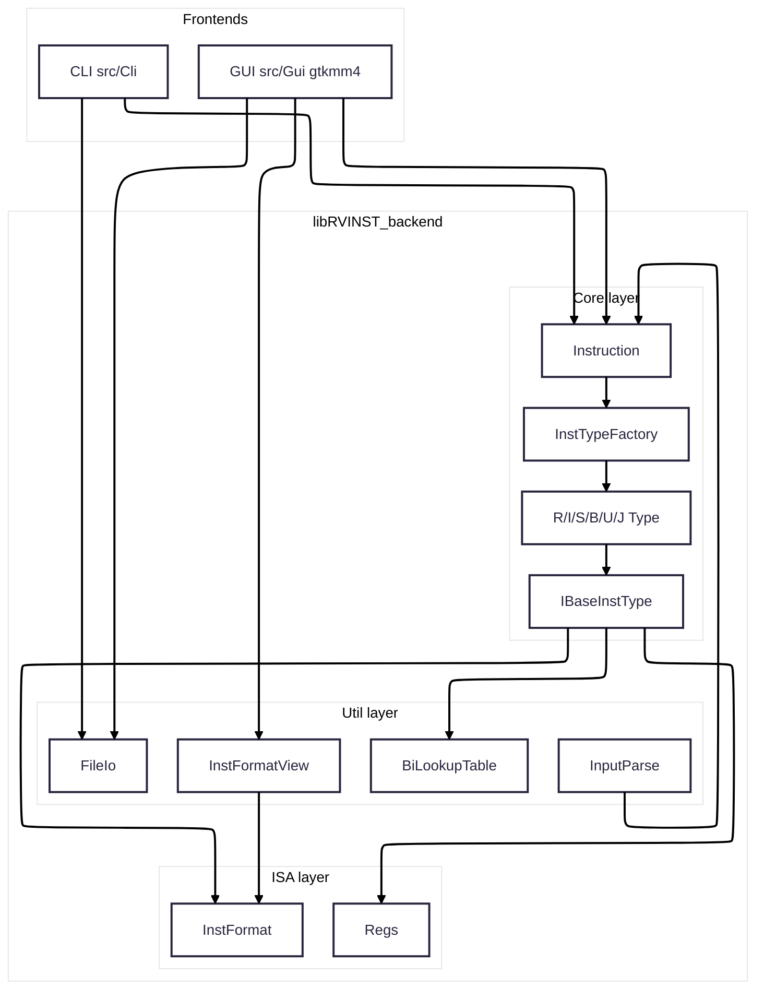
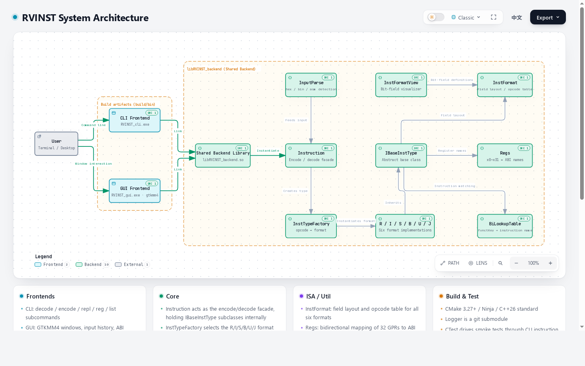

# RVINST

A RISC-V instruction encoder/decoder and visualization tool. It supports the six instruction formats (R / I / S / B / U / J) of the RISC-V base integer instruction set (RV32I; more will be supported later), and provides two frontends — a command-line interface (CLI) and a GTKMM4 graphical interface — for bidirectional conversion among hexadecimal, binary, and assembly forms, plus bit-field layout visualization.

**Supported platforms:** Linux and Windows. On Windows, building under **[MSYS2][MSYS2]** (CLANG64 or UCRT64) is recommended.

## Preview

CLI encode of `jal x1, 15` (field table + bit diagram):



GTKMM4 GUI parse of the same instruction (assembly / binary / hex + J-Type bit map):



## Features

- **Decode / Encode**: Accepts hex (`0x008100b3`), binary (`0b00000000...`), and assembly (`add x1, x2, x8`) inputs, auto-detects the input kind and converts in both directions
- **Six instruction formats**: Full bit-field parsing and field display for R, I, S, B, U, and J type instructions
- **Field-level visualization**: Prints a field table (Field, Bits, Value, Detail) and a bit-field diagram for each instruction; register fields are resolved to both architectural and ABI names
- **Register lookup**: Built-in bidirectional mapping of all 32 general-purpose registers (x0~x31) and their ABI names (zero / ra / sp / ...)
- **Batch file input**: `file <path>` / REPL `:file` process one instruction per line
- **Two frontends**:
  - CLI: `decode` / `encode` / `repl` / `file` / `reg` / `list` with colored, plain, and JSON output; optional history persistence
  - GUI: GTKMM4 interface with input history, settings (ABI / hex imm / save history / compact font), file open, per-format panels, and hover highlighting
- **Version info**: Short git hash is injected at configure time

## Requirements

- `CMake 3.25+`, `Ninja`
- A compiler with C++23/26 support (GCC 14+ or Clang 18+, using `<format>` / `<print>` / `<expected>`)
- Threads (pthread)
- **GUI frontend**: `gtkmm-4.0` (via pkg-config: `pkg-config --exists gtkmm-4.0`)
- **Logger submodule**: must be initialized
- Optional: `clang-format`, `clang-tidy` (targets `fmt` / `tidy`)

### Install dependencies

Install a C++23/26 toolchain, CMake, Ninja, pkg-config, and gtkmm-4.0 (for the GUI). Optional packages enable the `fmt` / `tidy` targets.

**Linux**

```bash
# Arch Linux
sudo pacman -S base-devel cmake ninja pkgconf \
               gcc clang \
               gtkmm-4.0
# clang package also ships clang-format / clang-tidy

# Debian / Ubuntu (24.04+ recommended for a recent GCC/Clang)
sudo apt install build-essential cmake ninja-build pkg-config \
                 g++ clang \
                 libgtkmm-4.0-dev \
                 clang-format clang-tidy

# Fedora
sudo dnf install cmake ninja-build pkgconf-pkg-config \
                 gcc-c++ clang \
                 gtkmm4.0-devel \
                 clang-tools-extra   # clang-format / clang-tidy
```

Verify:

```bash
cmake --version
ninja --version
c++ --version          # or: clang++ --version
pkg-config --modversion gtkmm-4.0
```

**Windows (MSYS2 — recommended)**

Open an **MSYS2 CLANG64** or **UCRT64** shell and install the matching prefix packages (do not mix prefixes):

```bash
# CLANG64 (recommended; matches a typical clang64 PATH)
pacman -S mingw-w64-clang-x86_64-toolchain \
          mingw-w64-clang-x86_64-cmake \
          mingw-w64-clang-x86_64-ninja \
          mingw-w64-clang-x86_64-pkgconf \
          mingw-w64-clang-x86_64-gtkmm-4.0 \
          mingw-w64-clang-x86_64-clang-tools-extra   # optional: clang-format / clang-tidy

# or UCRT64 (GCC)
pacman -S mingw-w64-ucrt-x86_64-toolchain \
          mingw-w64-ucrt-x86_64-cmake \
          mingw-w64-ucrt-x86_64-ninja \
          mingw-w64-ucrt-x86_64-pkgconf \
          mingw-w64-ucrt-x86_64-gtkmm-4.0 \
          mingw-w64-ucrt-x86_64-clang-tools-extra    # optional: clang-format / clang-tidy
```

Verify (all tools should live under the same prefix — `/clang64` or `/ucrt64`):

```bash
pkg-config --modversion gtkmm-4.0
which cmake ninja c++
cmake --version && ninja --version && c++ --version
```

## Build

### 1. Clone and initialize submodules

```bash
git clone https://github.com/BaiLei27/RVINST.git --recurse-submodules
```

### 2. Configure and build

Use one toolchain prefix end-to-end. On Windows, prefer the MSYS2 CLANG64 (or UCRT64) shell from the previous section — not a mixed PATH.

```bash
cd <path/RVINST>
cmake -B build-x86_64 -G Ninja -DCMAKE_BUILD_TYPE=Release
cmake --build build-x86_64
```

Artifacts land in `build-x86_64/bin/`:

| Artifact                             | Description                           |
| ------------------------------------ | ------------------------------------- |
| `RVINST_cli.exe`                     | CLI frontend                          |
| `RVINST_gui.exe`                     | GTKMM4 GUI                            |
| `libRVINST_backend` (`.dll` / `.so`) | Shared backend used by both frontends |

### 3. Code checks (optional)

```bash
cmake --build build-x86_64 -t fmt    # clang-format
cmake --build build-x86_64 -t tidy   # clang-tidy
```

> For cross-compilation (e.g. a RISC-V Linux toolchain), see `cmake/Modules/ToolsChainConf.cmake`.

## Usage

### CLI

```text
rvinst <command> [options] [args]
```

On Windows / MSYS2 the binary is typically `./build-x86_64/bin/RVINST_cli.exe`.

#### Commands

| Command           | Description                                                           |
| ----------------- | --------------------------------------------------------------------- |
| `decode <input>`  | Decode hex / binary (or assembly) and print fields                    |
| `encode <input>`  | Encode assembly to hex / binary and print fields                      |
| `repl`            | Interactive REPL                                                      |
| `file <path>`     | Process a text file one non-empty line at a time                      |
| `reg <query>`     | Look up a register by name or index (`a0`, `10`, `x10`, …)            |
| `list [--type T]` | List supported instructions; `T` is `R` / `I` / `S` / `B` / `U` / `J` |

#### Global options

| Option            | Description                                                           |
| ----------------- | --------------------------------------------------------------------- |
| `--abi`           | Use ABI register names (`zero`, `ra`, `sp`, …)                        |
| `--no-abi`        | Use architectural names (`x0`, `x1`, …) **[default]**                 |
| `--json`          | JSON output                                                           |
| `--save-history`  | Persist REPL history under the build `gen/data` dir (`inputHist.log`) |
| `-h`, `--help`    | Show help                                                             |
| `-v`, `--version` | Show version / commit / URL                                           |

#### Input formats

| Kind     | Examples                                                         |
| -------- | ---------------------------------------------------------------- |
| Hex      | `0x008100b3`, `008100b3`                                         |
| Binary   | `0b00000000100000010000000010110011`, or a 32-bit `0`/`1` string |
| Assembly | `add x1, x2, x8`, `jal x1, 15`                                   |

#### Examples

```bash
./build-x86_64/bin/RVINST_cli.exe decode 0x008100b3
./build-x86_64/bin/RVINST_cli.exe decode 0x008100b3 --abi
./build-x86_64/bin/RVINST_cli.exe encode "add x1, x2, x8"
./build-x86_64/bin/RVINST_cli.exe encode "jal x1, 15"
./build-x86_64/bin/RVINST_cli.exe file tests/inst_sets.txt
./build-x86_64/bin/RVINST_cli.exe reg a0
./build-x86_64/bin/RVINST_cli.exe reg 10
./build-x86_64/bin/RVINST_cli.exe list --type R
./build-x86_64/bin/RVINST_cli.exe repl
./build-x86_64/bin/RVINST_cli.exe repl --save-history --abi
```

#### REPL

Enter with `repl`. Paste hex / binary / assembly lines directly. Colon-commands:

| Command                                          | Description                       |
| ------------------------------------------------ | --------------------------------- |
| `:help`, `:h`                                    | Show REPL help                    |
| `:abi on\|off`                                   | Toggle ABI names                  |
| `:json on\|off`                                  | Toggle JSON output                |
| `:list [--type T]`                               | List instructions                 |
| `:hist`                                          | Show input history (newest first) |
| `:file <path>`                                   | Batch-decode a file into history  |
| `quit` / `q` / `exit` / `:quit` / `:q` / `:exit` | Leave the REPL                    |

Arrow keys browse history when a TTY is available.

### GUI

```bash
./build-x86_64/bin/RVINST_gui.exe
```

- Enter hex / binary / assembly and click **Parse Instruction**
- History: arrow keys / history popover
- Settings (gear): ABI names, hex immediates, save history, compact font
- Open file (folder icon): batch-decode a `.txt` / `.log` / `.data` file
- Format card: J/R/I/… bit map with hover highlighting; manual link opens the RISC-V docs

## Architecture



### Interactive diagram

- [Interactive architecture diagram](https://bailei27.github.io/RVINST/architecture/rvinst-architecture.html) — GitHub Pages
- [Interactive architecture diagram (repo file)](docs/architecture/rvinst-architecture.html) — open locally if Pages is unavailable

[](https://bailei27.github.io/RVINST/architecture/rvinst-architecture.html)

## Links

- [RVINST](https://github.com/BaiLei27/RVINST.git)
- [Logger](https://github.com/BaiLei27/Logger.git)
- [RISC-V instruction manual](https://riscv.github.io/riscv-unified-db/manual/html/isa/isa_20240411/index.html)
- [RISC-V ISA docs](https://docs.riscv.org/reference/isa/)

[MSYS2]: https://www.msys2.org/
